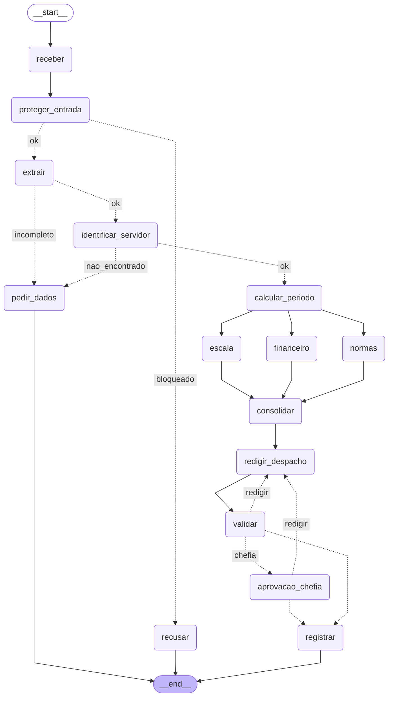

# Entrega: Assistente de Gestão de Pessoas

**Aluno(s):** Suellyn Schopping
**Até onde chegou:** ( ) Marco mínimo (Etapa 6)  (X) Marco completo (Etapa 9)  ( ) Etapas 10–11
**Opcionais e bônus feitos:** ( ) 🆕 A  ( ) 🆕 B  ( ) 🆕 C  ( ) Outro: ______
**Repositório:** https://github.com/suellynschopping/assistente-rh-aula10

## Etapa 0: quem verifica cada regra?

| Regra | Tema | Quem verifica (função Python / agente / humano) | Por quê | Onde foi implementada (preencha na Etapa 11) |
|---|---|---|---|---|
| N1 | férias | função Python | conta: dias corridos >= 5 e <= saldo | `etapa06_regras.py` -> `violacoes_objetivas` (ramo `tipo == "ferias"`) |
| N2 | férias | função Python | conta: dias + vendidos <= saldo, vendidos <= 10 | `etapa06_regras.py` -> `violacoes_objetivas` + `Pedido.dias_vendidos (<=10)` |
| N3 | férias | função Python | consulta de calendário (feriados e fim de semana) | `etapa04_ferramentas.inicio_permitido` chamado via `resumo_periodo` |
| N4 | prazos | função Python | diferença entre datas (dias corridos ou úteis) | `etapa06_regras.violacoes_objetivas` + `_dias_uteis_ate` |
| N5 | escala | função Python | contagem de afastados da equipe no período x limite de 30% | `dados_rh.escala_da_equipe` (via MCP `consultar_escala`) + `violacoes_objetivas` |
| N6 | abono | função Python | dia útil e saldo de abonos | `etapa06_regras.violacoes_objetivas` (ramo `tipo == "abono"`) |
| N7 | diária | função Python (regra) + agente Financeiro (cálculo) | conta: diárias + meia + câmbio; o Financeiro explica | `etapa06_agentes.criar_financeiro` + `tabela_diarias`/`cotacao_dolar` |
| N8 | aprovação | humano (chefia) + função Python no MCP server | é decisão da chefia; o server só confere se o aprovador é a chefia certa | `etapa07_grafo.aprovacao_chefia` (interrupt) + `etapa05_mcp_rh.registrar_decisao` (nega autoaprovação e chefia errada) |
| N9 | saúde | função Python (guardrail) + agente classificador | regex de CID/CPF barra antes de qualquer agente ver o texto; o classificador cobre o que a regex não pega | `etapa03_guardrails.encontrar_dado_sensivel` + `criar_classificador` |
| N10 | dados | função Python (guardrail de saída) | regex no despacho antes de gravar | `etapa07_grafo.registrar` chama `encontrar_dado_sensivel` antes do MCP |

## Etapa 11: os 12 casos

Compare **caminho e estado**, não o texto do despacho. Caminhos abaixo foram validados em
`python conferir.py` (sem --llm, com respostas fixas no lugar do modelo); protocolos vêm
de `gerar_protocolo` (SHA-256 dos campos). Preencha a coluna "Bateu com o esperado?"
após rodar `python etapa07_grafo.py --todos` com o LLM real.

| Caso | Caminho percorrido | Resultado | Bateu com o esperado? |
|---|---|---|---|
| C1_abono_simples | receber -> proteger_entrada -> extrair -> identificar_servidor -> calcular_periodo -> normas\|escala\|financeiro -> consolidar -> redigir_despacho -> validar -> registrar | registrado (deferido) · protocolo `ae788d33` | (preencha após rodar com LLM) |
| C2_ferias_com_venda | ... -> validar -> aprovacao_chefia (PAUSA) -> (retomar "sim" por 1010) -> registrar | pausou na chefia; depois do sim de 1010 -> registrado · protocolo `b7b6f485` | (preencha após rodar com LLM) |
| C3_dado_de_saude | receber -> proteger_entrada -> recusar | BLOQUEADO (regex CPF/CID) | (preencha após rodar com LLM) |
| C4_fora_do_escopo | receber -> proteger_entrada -> recusar | BLOQUEADO (fora_do_escopo, nota >= 0,7) | (preencha após rodar com LLM) |
| C5_sem_matricula | receber -> proteger_entrada -> extrair -> pedir_dados | pediu_dados (sem matrícula/datas) | (preencha após rodar com LLM) |
| C6_conflito_de_escala | caminho completo -> registrar | registrado (indeferido por N5) · protocolo `6f1b47d7` | (preencha após rodar com LLM) |
| C7_autoaprovacao | receber -> proteger_entrada -> recusar | BLOQUEADO (manipulação); sem guardrail: indeferido por N4 e, se tentar autoaprovar, DENY do server | (preencha após rodar com LLM) |
| C8_idempotencia | mesmo caminho do C1 -> registrar | duplicado · mesmo protocolo `ae788d33` (não grava de novo) | (preencha após rodar com LLM) |
| C9_divergencia | receber -> proteger_entrada -> extrair -> pedir_dados | pediu_dados (datas vagas); com 🆕 A: votação -> divergencia=True | (preencha após rodar com LLM) |
| C10_zona_cinzenta | depende do LLM: nota pode ficar entre 0,3 e 0,7; se passar, vai para pedir_dados (sem data) | pediu_dados ou bloqueado (dep. do LIMIAR); com 🆕 C: pausa em triagem_humana | (preencha após rodar com LLM) |
| C11_diaria_exterior | ... -> aprovacao_chefia (PAUSA) -> (retomar "sim" por 1011) -> registrar | pausou na chefia; depois do sim de 1011 -> registrado · protocolo `ec67dba1` | (preencha após rodar com LLM) |
| C12_inicio_proibido | caminho completo -> registrar | registrado (indeferido por N3) · protocolo `7c458e62` | (preencha após rodar com LLM) |

## O grafo

## Etapa 4 (pronta): o que eu entendi

- **Diferença entre a saída online e a offline:** online, `buscar_feriados` chama a BrasilAPI e retorna `fonte: brasilapi` com a cotação real do dólar; offline (`FERIADOS_OFFLINE=1`), aparecem as 3 tentativas do `[retry]` seguidas de `fonte: arquivo_local` e `cotação USD->BRL: None`.
- **Por que a espera do retry dobra a cada tentativa:** é *backoff exponencial* (0,5s → 1s → 2s). Dar um respiro à API em caso de pico de carga evita amplificar o problema. Se todos os clientes retentassem imediatamente, o serviço travaria mais.
- **Por que o protocolo é um hash dos campos (e não um número sequencial):** o hash dos campos normalizados dá *idempotência* — o mesmo pedido sempre produz o mesmo protocolo, então reenvios não geram duplicatas (C8 reaproveita o protocolo do C1: `ae788d33`). Um número sequencial exigiria estado centralizado e permitiria duas gravações do mesmo pedido com números diferentes.
- **O que aconteceria sem o cache de feriados:** `dias_uteis` chama `eh_dia_util` dia por dia, e cada chamada acessaria a BrasilAPI de novo. Para um período de 15 dias, seriam 15+ requisições — lento, caro e com risco de hitting rate limit (ou de HTTP 5xx). O cache torna o custo O(1) por ano consultado.

## Observabilidade (C2)

- Onde o tempo foi gasto: (Etapa 10 não implementada nesta entrega — `etapa10_observabilidade.medido()` ainda é pass-through)
- Tokens totais: ___

## Opcionais (preencha só os que fez)

- 🆕 A: não implementado nesta entrega
- 🆕 B: não implementado nesta entrega
- 🆕 C: não implementado nesta entrega

## Reflexão (até 3 linhas cada)

1. **Quem decide o caminho no seu sistema?** O **grafo** decide a estrutura (quem roda, quando, em paralelo); as **regras** (`violacoes_objetivas`) decidem deferido/indeferido para o que é cálculo; o **LLM** decide a *redação* e o conteúdo dos pareceres (Normas, Escala, Financeiro); o **humano** (chefia) decide aprovar ou rejeitar via `interrupt()`. Ex.: C6 (regra), C2 (LLM + humano), C3 (regra: guardrail), C1 (grafo pula a chefia por N8).
2. **Se o guardrail de entrada falhar, o que ainda impede uma autoaprovação?** O MCP server nega gravações onde `aprovador == matricula` (regra N8 implementada em `registrar_decisao`). Mesmo que alguém escreva "eu aprovo" e burle o classificador, a autorização final é no server, que compara contra o cadastro.
3. **Por que o nó da chefia não pode gravar nada antes do `interrupt()`?** Porque, na retomada, o LangGraph roda o nó inteiro de novo desde o início. Qualquer efeito colateral (gravação, chamada MCP) seria executado duas vezes — para a chefia, isso significaria registros duplicados ou mensagens repetidas.
4. **Qual dado veio do MCP, qual de API externa e qual de tool local? Por que?** MCP: cadastro de servidores, escala, normas, diárias (dados próprios da organização; benefit: isola o LLM dos CSVs e permite autorização centralizada). API externa: feriados BrasilAPI e câmbio Frankfurter (dados do mundo que mudam fora da organização). Tool local: `cotacao_dolar` embrulha a API para o Financeiro (cache + fallback). A divisão separa **o que é nosso** (MCP), **o que é do mundo** (APIs) e **o que é cálculo próprio** (Python puro em `etapa06_regras.py`).
5. **O que você mudaria para colocar este sistema em produção?** (a) Substituir o SQLite checkpointer por Postgres; (b) armazenar o `TOKEN_REGISTRO` num segredo (Vault/KMS) e rotacioná-lo; (c) adicionar observabilidade real (Langfuse/OpenTelemetry) para rastrear custo e latência; (d) autenticar o aprovador (OAuth/SSO + MFA) em vez de confiar na matrícula; (e) HTTPS no MCP com mTLS, não stdio; (f) feature flags para o guardrail e limites de tentativa.
6. (não implementado)
7. (não implementado)
8. (não implementado)

## De onde veio cada parte

| Arquivo / trecho | Exemplo das aulas em que me baseei | O que precisei adaptar |
|---|---|---|
| `etapa01_agente.py` (`consultar_servidor`, `criar_atendente`) | `aula1/segundo_agente.py` + `exercicios_resolvidos/aula4/ex10_function_tool.py` | Trocar o domínio (ocorrências → cadastro de servidores) e explicitar na docstring que o salário NÃO sai |
| `etapa02_extracao.py` (`Pedido`, `criar_extrator`) | `aula2/agente_output2.py` | Trocar `Ocorrencia` por `Pedido` de RH com Enums `TipoPedido`/`TipoDestino`; usar `texto_hoje()` para datas relativas |
| `etapa03_guardrails.py` (`criar_classificador`, `barrar_fora_do_escopo`) | `aula2/agente_guardrail.py` | Dar exemplos específicos de "mudar as regras" (N7 do curso) para pegar C7_autoaprovacao |
| `etapa05_mcp_rh.py` (tools de leitura e `registrar_decisao`) | `aula6/desafio2/mcp_unidades.py` + `aula5/exemplos/10_seguranca/server_seguro.py` | Separar leitura/escrita, embrulhar lista em dict (`consultar_normas`) e trazer N8 para o server |
| `etapa06_agentes.py` (especialistas + Coordenador) | `aula4/ex03_agente_as_tool.py` + `aula7/exemplos/02_agentes_especializados/main.py` | Dar a cada especialista APENAS suas tools; usar `failure_error_function=None` nas `as_tool` |
| `etapa07_grafo.py` (grafo com fan-out/fan-in, ciclo e `interrupt()`) | `aula7/exemplos/08_paralelismo` + `aula6/exemplos/08_fluxo_ciclico` + `aula7/exemplos/07_aprovacao_revisao` | Juntar os três padrões num grafo só; reducer em `violacoes`; `MAX_TENTATIVAS` no roteador para parar o ciclo |